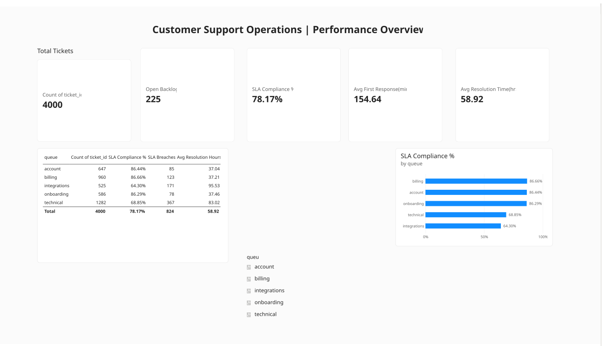

# Customer Support Operations Improvement

**Business Analysis · Process Improvement · Power BI · SQL · DMAIC**

> **Portfolio case study, not a real-company engagement.** The source is a public **synthetic** SaaS support-ticket dataset. A **72-hour resolution SLA** was assumed for analytical purposes. Recommendations are proposed, **not implemented outcomes**.

## Business problem

A customer support operation has uneven case resolution performance across queues. I analyzed **4,000 simulated tickets** with SQLite and Power BI to identify service-level gaps, measure workload, and propose a controlled improvement pilot.

| Operational KPI | Baseline |
|---|---:|
| Total tickets | **4,000** |
| Unresolved tickets at extraction | **225** |
| Resolved tickets | **3,775** |
| Resolution SLA compliance | **78.17%** |
| SLA breaches (>72 h among resolved cases) | **824** |
| Average first response | **154.64 min** |
| Average resolution time (resolved only) | **58.92 h** |

**Key finding:** Technical (367 breaches) and Integrations (171 breaches) account for **65.3% of all 824 breaches**. Technical contributes the highest absolute number; Integrations has the lowest resolution SLA rate (**64.30%**).

## Dashboard screenshots

*Static screenshot extracted from the supplied two-page Power BI PDF. It shows the baseline KPI cards and queue SLA analysis. This PDF export predates the later monthly-volume chart; therefore that chart is not shown in this screenshot.*

[View priority and queue detail page](screenshots/priority_queue_analysis_export.svg)

## Analysis and proposed action

| Queue | Tickets | SLA compliance | Breaches |
|---|---:|---:|---:|
| Account | 647 | 86.44% | 85 |
| Billing | 960 | 86.66% | 123 |
| Integrations | 525 | 64.30% | 171 |
| Onboarding | 586 | 86.29% | 78 |
| Technical | 1,282 | 68.85% | 367 |

**Proposal:** Pilot ticket ownership, daily aging reviews, a **48-hour warning** and **60-hour escalation** for Technical Normal/Low cases; investigate Integrations case histories in parallel. Suggested 12-week target: move overall SLA compliance from 78.17% toward **85%** without increasing backlog or reducing High/Urgent performance. The proposed controls and targets are hypotheses, not demonstrated improvements.

## Project deliverables

- [English Business Case](reports/business_case.md)
- [DMAIC Analysis and Improvement Plan](reports/dmaic_improvement_plan.md)
- [AS-IS conceptual process map](process/as_is_process.md) and [TO-BE proposal](process/to_be_process.md)
- [SQL KPI verification](sql/kpi_analysis.sql) and [original authored queue query](sql/author_original_queue_query.sql)
- [Synthetic source data — CSV](data/support-tickets.csv)
- [Metrics, assumptions and limitations](reports/metrics_and_assumptions.md)
- [Power BI Desktop source report](powerbi/operations_dashboard.pbix) and [DAX / model notes](powerbi/dax_measures.md)
- [How to reproduce](REPRODUCE.md)

**Power BI source report:** [Download the Power BI Desktop file](powerbi/operations_dashboard.pbix) (`.pbix`) to inspect the DAX measures and interactive report, including the monthly-volume trend. The static screenshots above were captured from an earlier PDF export and do not show the later monthly chart.

## Analytical workflow

1. Inspect missing fields and date types in Power Query.
2. Build DAX cards: ticket count, open backlog, response time, resolution time, resolution SLA.
3. Compare queues, priorities and monthly volume. Exclude the incomplete **February 2024** from the monthly trend *only*, not from overall KPI totals.
4. Cross-check total/open/breach metrics and queue breakdown using **SQLite**.
5. Translate findings into a **DMAIC** plan with explicit root-cause hypotheses and an implementation/control design.

## Scope and limitations

- Data are synthetic, publicly sourced from [Datanemics Customer Support Tickets](https://datanemics.com/datasets/support-tickets/) (source description: CC0). No real customer information or actual company process is represented.
- Missing first-response data (~4%) and CSAT (~69%) limit customer-experience conclusions.
- `resolved_at IS NULL` means unresolved at extraction, **not automatically late**.
- Resolution averages exclude unresolved tickets; this creates potential survivorship bias.
- The AS-IS flow is **conceptual**, not empirically observed. Proposed queue-management root causes must be validated through workflow logs and stakeholder interviews.
- No implemented benefit, cost saving, before/after uplift or real customer impact is claimed.

## Reproduce

See [REPRODUCE.md](REPRODUCE.md) for CSV import, SQL instructions and Power BI model notes. SQL results independently match the report baseline: **4,000 total**, **225 unresolved**, **824 breaches**, and queue breakdown **85 / 123 / 171 / 78 / 367**.
