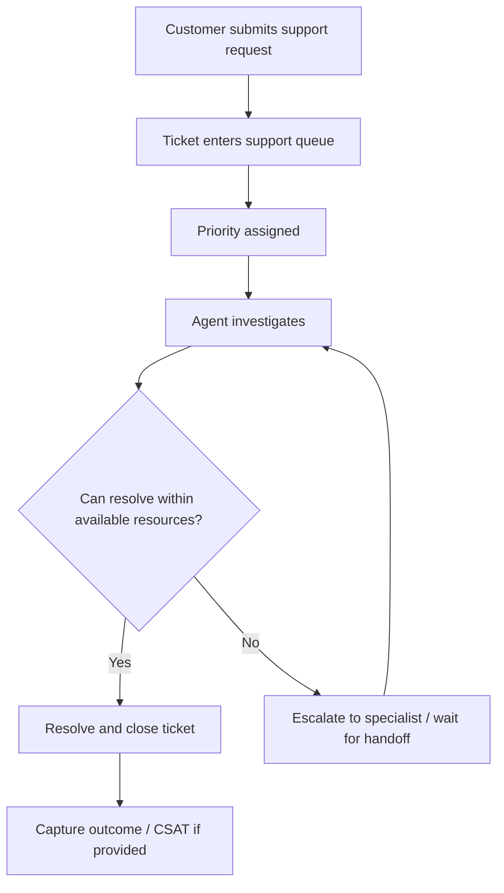

# AS-IS process map (conceptual, not observed)

This is a **working hypothesis**. The synthetic ticket dataset does not contain handoff logs, queue ownership or workflow events sufficient to validate an actual current-state process.

**Validation needs:** interviews with queue leads, event timestamps, handoff count, assignment latency, reopened ticket history, actual SLAs by priority and ticket type.
