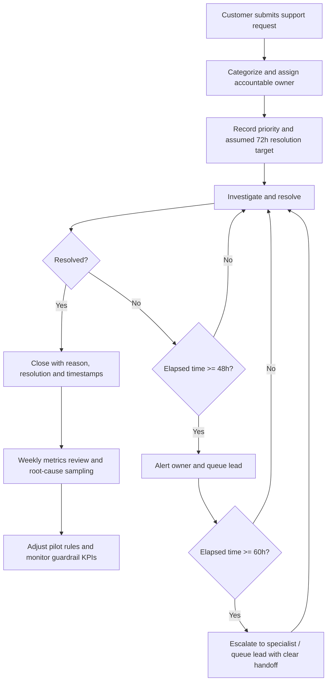

# Proposed TO-BE process map (not implemented)

This is a **pilot design**, not an observed or tested improvement. Alert and escalation thresholds are candidate policies to validate.

**Pilot:** Technical Normal/Low first, while separately sampling Integrations tickets. **Guardrails:** monitor High/Urgent response, reopening, backlog, and queue mix so gains are not from relabeling or shifting work.
